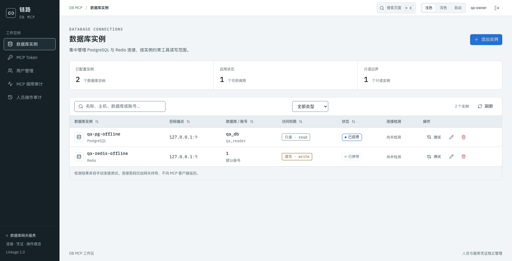

<div align="center">

# DB MCP

**让 AI 连接数据库，也让每次数据操作有迹可循。**

[](https://hub.docker.com/r/lijx559/db-mcp)
[](docs/releases/2026-10-30-dockerhub.md)
[](https://gofastmcp.com)

**简体中文** · [English](README.en.md)

[产品能力](#features) · [Docker Compose 部署](#deploy) · [MCP 接入](#connect) · [运维](#operations)

</div>

面向 PostgreSQL 与 Redis 的自托管 MCP 网关。集中管理连接与凭据，按实例控制只读/读写边界，通过一个工作台查看配置操作和数据库调用。



<sub>截图来自独立演示环境，不包含真实生产资源或凭据。</sub>

<a id="features"></a>

## 产品能力

| 能力 | 你可以做什么 |
|---|---|
| 多实例管理 | 统一维护 PostgreSQL、Redis 连接，支持连通性测试与配置热更新。 |
| 数据操作 | 31 个 MCP 工具覆盖 SQL 查询、表结构浏览及 Redis 常用数据类型。 |
| 读写边界 | 实例默认只读；PostgreSQL 叠加工具权限、SQL 静态分析与只读事务。 |
| 危险操作确认 | 高危 DDL 需要 `confirm=true`，保留显式确认入口。 |
| 独立凭证与双审计 | 人员登录与 MCP token 分离；追踪实际数据库目标，默认保留 30 天。 |
| 统一工作台 | Linkage 界面、三态主题、命令面板与响应式表格。 |

<a id="deploy"></a>

## Docker Compose 部署

需要 Docker Engine（或 Docker Desktop）与 Docker Compose v2。无需克隆源码，镜像已包含完整管理页面。部署机器需要能访问目标数据库。

### 1. 准备部署目录

以下命令适用于 Linux/macOS 普通用户。`.env` 会保存端口、镜像和运行 UID/GID；后续重启继续使用相同配置。

```bash
mkdir -p db-mcp/runtime
cd db-mcp
umask 077
cat > .env <<EOF
COMPOSE_PROJECT_NAME=db-mcp
DOCKER_UID=$(id -u)
DOCKER_GID=$(id -g)
DBMCP_IMAGE=lijx559/db-mcp:2.1.0
DBMCP_BIND_ADDRESS=127.0.0.1
DBMCP_PORT=8807
TZ=Asia/Shanghai
EOF
```

若以 root 部署，在 `.env` 中把 `DOCKER_UID` / `DOCKER_GID` 设为专用非 root 账号的 UID/GID，并将 `runtime/` 属主调整为相同值，例如 `chown -R 1000:1000 runtime`。镜像默认使用 UID/GID `1000:1000`。

### 2. 保存 `docker-compose.yml`

```yaml
name: db-mcp
services:
  db-mcp:
    image: ${DBMCP_IMAGE:-lijx559/db-mcp:2.1.0}
    restart: unless-stopped
    user: "${DOCKER_UID:-1000}:${DOCKER_GID:-1000}"
    ports:
      - "${DBMCP_BIND_ADDRESS:-127.0.0.1}:${DBMCP_PORT:-8807}:8807"
    volumes:
      - ./runtime:/data
    env_file:
      - .env
    environment:
      TZ: ${TZ:-Asia/Shanghai}
    stop_grace_period: 20s
```

固定版本与 `latest` 均支持 **`linux/amd64` / `linux/arm64`**，Docker 自动选择架构。建议部署使用固定版本。也可直接下载本仓库的 [docker-compose.yml](docker-compose.yml) 与 [.env.example](.env.example)。

### 3. 初始化并启动

```bash
docker compose pull
docker compose run --rm db-mcp db-mcp --init --config /data/config.yaml
docker compose up -d
docker compose ps
curl -fsS http://127.0.0.1:8807/healthz
```

`--init` 仅首次创建空配置，不覆盖已有文件；已有部署升级时跳过初始化命令。健康接口返回 `{"ok":true}` 后，打开 **http://127.0.0.1:8807/**。

### 4. 创建首位用户

```bash
docker compose exec db-mcp cat /data/data/setup.key
```

把一次性初始化码填入页面，设置用户名与独立密码。初始化完成后该文件自动删除，没有默认登录账号。

在「数据库实例」中添加 PostgreSQL 或 Redis，选择只读/读写并测试连接；再到「MCP Token」创建客户端专用 token。容器需要能直连目标数据库，数据库原有账号权限仍然生效。

### Compose 配置说明

| 配置 | 默认值 | 说明 |
|---|---|---|
| `COMPOSE_PROJECT_NAME` | `db-mcp` | 同机多套部署使用不同项目名、宿主端口与运行目录。 |
| `DBMCP_IMAGE` | `lijx559/db-mcp:2.1.0` | 固定镜像版本，升级时显式修改。 |
| `DBMCP_BIND_ADDRESS` | `127.0.0.1` | 默认仅本机可访问；需要局域网直连时改为 `0.0.0.0`。 |
| `DBMCP_PORT` | `8807` | 宿主端口；容器内端口仍为 `8807`。 |
| `DOCKER_UID` / `DOCKER_GID` | `1000` / `1000` | 必须对 `runtime/` 有读写权限。 |
| `./runtime:/data` | 目录挂载 | 同时持久化配置、身份、token 与审计，不能改为仅挂载单个配置文件。 |
| `env_file: .env` | `.env` | 将资源凭据注入容器；`.env` 同时参与 Compose 变量替换。 |
| `TZ` | `Asia/Shanghai` | 容器时区；审计时间以 UTC 存储。 |

配置样例见 [config.example.yaml](config.example.yaml)。实际配置为 `runtime/config.yaml`；配置中的相对路径以配置文件目录为基准。`${VARIABLE}` 从**容器环境**读取，缺少变量会报错；凭据可添加到 `.env`，不要把网页密码或 MCP token 写进该文件。网页保存配置保留环境变量引用，但会丢失 YAML 注释。

容器中的 `127.0.0.1` 指向容器自身。目标服务运行在宿主机时，Docker Desktop 可使用 `host.docker.internal`；Linux 可按环境添加 `extra_hosts: ["host.docker.internal:host-gateway"]`。连接远端资源时填写容器可达的地址。

<a id="connect"></a>

## MCP 接入

在工作台创建并保存 MCP token，然后为支持 HTTP 的客户端添加配置：

```json
{
  "mcpServers": {
    "db-mcp": {
      "type": "http",
      "url": "http://127.0.0.1:8807/mcp",
      "headers": {"Authorization": "Bearer <MCP_TOKEN>"}
    }
  }
}
```

上例适用于客户端和服务在同一台机器。远程接入请把 URL 换成网关的实际 HTTPS 地址；已有网关的用户无需再启动一份服务。使用 token 后可先调用 `list_instances` 获取资源名称。

| 工具 | 用途 |
|---|---|
| `list_instances` / `db_ping` | 发现实例，检查版本、连通性与延迟。 |
| `postgres_query` / `postgres_execute` | 只读查询与受控写入。 |
| `postgres_list_schemas` / `postgres_list_tables` | 浏览 schema、表和视图。 |
| `postgres_describe_table` / `postgres_list_indexes` | 查看字段、约束与索引。 |
| `redis_get` / `redis_scan` / `redis_type` 等 | 读取 string/hash/list/set/zset、遍历 key 与查询元信息。 |
| `redis_set` / `redis_del` / `redis_expire` 等 | 在 write 实例上写入、删除、修改集合与过期时间。 |

每个实例使用 `permissions: read` 或 `write`，默认 `read`。SQL 每次只允许一条语句；高危 `DROP`/`TRUNCATE`/`ALTER` 需要 `confirm=true`。查询默认最多返回 1000 行、50000 个结果字符；大数据集优先用 `redis_scan`。SQL 词法分析不能判断任意存储过程的内部行为，只读事务是数据库侧的兜底。网络错误后的重试不保证写操作仅执行一次。

## 人员、凭证与审计

- 网页使用用户名/密码、HttpOnly Cookie 会话与 CSRF 校验；所有启用人员同权。
- MCP token 与人员账号独立：新 token 只展示一次明文，后续只显示元数据；仅用于 `/mcp`，不能登录网页。
- 重启、升级或重建容器保留有效 token；创建新 token、停用创建者不会自动吊销旧 token。密码修改或人员停用会撤销该人员会话。
- 人员审计记录登录与配置变更；MCP 审计记录 token、实际实例类型/主机/端口/数据库/连接账号及 SQL 或 Redis 操作、结果和耗时。默认保留 30 天，可筛选、查看详情与导出 CSV。
- 审计不保存凭据或完整查询结果。SQL 和 Redis 参数可能包含业务数据，已识别凭据脱敏不能识别任意业务秘密。SQLite 审计不提供防篡改或跨系统事务保证。

<a id="operations"></a>

## 运维与升级

### 持久化位置

| 宿主路径 | 内容 |
|---|---|
| `runtime/config.yaml` | 服务与资源配置。 |
| `runtime/data/service.db` | 人员、会话与 token 验证值。 |
| `runtime/audit/audit.db` | 人员操作与 MCP 调用审计。 |
| `runtime/data/setup.key` | 仅首次初始化期间存在。 |

这些文件与 `.env`、`backups/` 均不应提交到 Git；升级或更换容器时保留整个 `runtime/`。

```bash
docker compose logs -f --tail=100
docker compose restart
docker compose down
```

`down` 停止并移除容器，不删除宿主 `runtime/`。停止服务会中断在途调用。

### 备份与更新

先停止服务再备份完整目录，包含 SQLite 的 WAL/SHM 文件；也可使用可靠的 SQLite 在线备份方式。

```bash
mkdir -p backups
docker compose stop
(umask 077; tar -czf "backups/runtime-$(date +%Y%m%d-%H%M%S).tar.gz" runtime .env docker-compose.yml)
docker compose start
```

修改 `.env` 中的 `DBMCP_IMAGE` 为已发布的新版本后执行：

```bash
docker compose pull
docker compose up -d
docker compose ps
```

从旧版本升级时，显式配置的旧 `auth.users` token 会幂等迁移并继续用于 MCP。空配置不生成默认凭证；人员与 MCP token 分开管理。旧 `audit_records` 迁移为 legacy，不补造历史身份。先在备份副本演练迁移。回滚需要匹配的镜像、配置与数据备份，不要删除身份库或重建 token 来处理登录问题。

### HTTPS 与反向代理

默认端口只绑定本机，适合放在 HTTPS 反向代理后。子路径部署示例：

```nginx
location /db-mcp/ {
    proxy_pass http://127.0.0.1:8807/;
    proxy_http_version 1.1;
    proxy_buffering off;
    proxy_read_timeout 600s;
}
```

在 `runtime/config.yaml` 中设置 `auth.cookie_secure: true`、`auth.cookie_path: /db-mcp/`，重启服务后使用 `https://mcp.example.com/db-mcp/` 与对应的 `.../db-mcp/mcp`。`proxy_pass` 尾斜杠会剥除前缀；页面资源和 API 使用相对路径。

### 常见问题

| 现象 | 处理 |
|---|---|
| 无法写配置或 SQLite | 检查 `.env` 中 UID/GID 与 `runtime/` 属主；保持整个目录可写。 |
| 远程浏览器无法打开页面 | 默认仅本机监听；使用 HTTPS 反代、SSH 隧道，或显式修改绑定地址。 |
| 网页登录后 MCP 仍认证失败 | 网页账号与 MCP token 分开管理，在 MCP Token 页面创建专用凭证。 |
| 容器连不上资源 | 检查容器网络、目标地址与防火墙，避免误用容器自己的 `127.0.0.1`。 |
| 提示初始化码文件不存在 | 首位用户创建后文件会删除，使用已有用户名/密码登录。 |

## 其他启动方式

三种方式都提供完整 HTTP MCP 服务与管理界面。

<details>
<summary>源码 + uv</summary>

Python 3.10+ 与 uv；完整兼容性以锁文件与实际运行环境为准。

```bash
uv sync --locked
uv run --locked db-mcp --init --config ./runtime/config.yaml
uv run --locked db-mcp --config ./runtime/config.yaml
```

CLI 支持 `--host`、`--port`、`--config`、`--data-dir`。`--data-dir` 相对启动目录解析，只覆盖路径，不自动移动已有数据。

</details>

<details>
<summary>Python 包 / uvx</summary>

```bash
uv build
uvx --from ./dist/db_mcp-2.1.0-py3-none-any.whl db-mcp --init --config /absolute/path/db-mcp/config.yaml
uvx --from ./dist/db_mcp-2.1.0-py3-none-any.whl db-mcp --config /absolute/path/db-mcp/config.yaml
```

wheel/sdist 包含默认配置和管理页面；也可 `uv tool install` 安装本地 wheel。当前只发布了 Docker 镜像，未宣称 PyPI 包或 GitHub Release 已发布。uvx 不读取源码的 `uv.lock`；生产完整复现优先使用固定镜像或源码锁文件。运行数据放在安装缓存以外的可写目录。

</details>

<a id="development"></a>

## 开发与项目

```bash
uv sync --locked
uv run --locked pytest
uv run --locked ruff check src tests
cd webui
npm ci
npm run build
```

前端改动后必须重建静态产物。需要本地构建容器时，在仓库根目录执行：

```bash
docker compose -f docker-compose.yml -f docker-compose.build.yml up -d --build
```

[开发约定](CLAUDE.md) · [发布摘要](docs/releases/2026-10-30-dockerhub.md) · [反馈问题](https://github.com/Lixiuxiu559/db-mcp/issues)

本服务独立开发、发布和部署，与 [MCP 工作空间](https://github.com/Lixiuxiu559/mcp) 共享统一规范，运行时不依赖父目录或其他 MCP 仓库。
